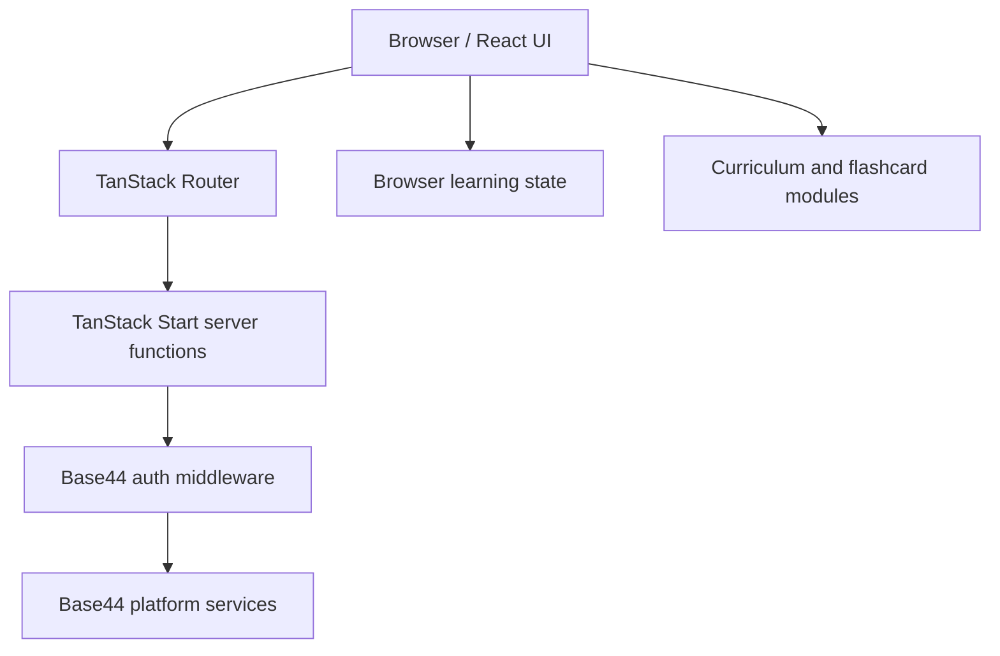
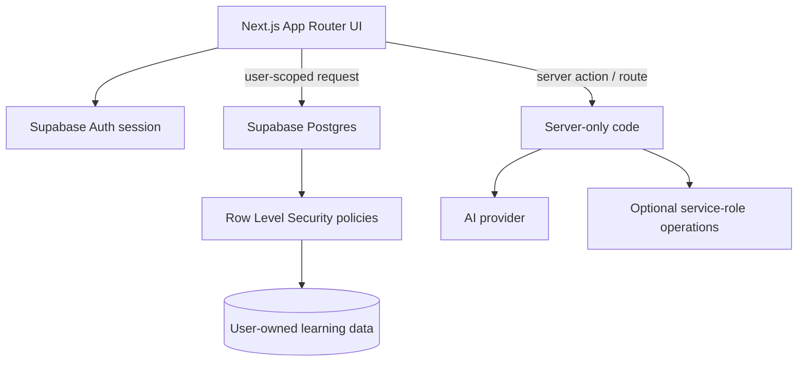

# Architecture

## Status and scope

This document describes the repository as it exists on `supabase-migration-review`. The production application is still the React 19 + TanStack Start application integrated with Base44. The Next.js + Supabase design is a migration target, not a completed replacement.

The SQL files in `supabase/migrations/` are review drafts only. They have not been applied to the connected Supabase project.

## Current runtime

- **UI:** React 19 with JavaScript/JSX.
- **Routing and server rendering:** TanStack Start and TanStack Router.
- **Build and development:** Vite with the Base44 and Cloudflare Vite plugins.
- **Styling:** Tailwind CSS and shared design tokens in `src/index.css`.
- **Current platform services:** Base44 SDK, authentication context and server middleware.
- **Learning state:** browser-local state managed in `src/lib/learn-store.jsx`.
- **Learning content:** curriculum, flashcards and lesson exercises in `src/data/`.

### Current request flow

The exact data flow varies by feature. Do not assume all learning progress is stored remotely: the current learning store includes browser-local persistence.

## Migration target

The reviewed target is a Next.js App Router application using Supabase Auth and Postgres. Migration work must be incremental and must preserve the existing Base44 application until the replacement is verified.

### Target trust boundaries

- Browser-visible Supabase project URL and publishable/anon key are configuration, not secrets.
- Supabase service-role credentials and AI provider credentials must remain server-side.
- User ownership must be derived from the authenticated session, never trusted from a client-supplied user ID.
- Row Level Security (RLS) must protect every exposed user-owned table.
- AI requests must be authenticated, input-validated and bounded for payload size and usage.

### Proposed target flow

This is a design target, not evidence that these components are already implemented.

## Migration safety invariants

1. Keep the current Base44 runtime available until the replacement passes functional and security checks.
2. Do not apply SQL drafts or alter the live database as part of a documentation or review task.
3. Keep service-role and provider secrets out of browser bundles, commits, logs and example values.
4. Enable and test RLS before exposing user-owned tables.
5. Make legacy-state import opt-in, authenticated, atomic and non-overwriting.
6. Preserve the original local state until imported data has been read back and verified.
7. Do not assume Base44 passwords, sessions or OAuth grants are portable to Supabase Auth.
8. Record migration decisions and test evidence before proposing production cutover.

## Key implementation areas

| Area | Location |
| --- | --- |
| Enabled course content | `src/data/curriculum.js` |
| Flashcard decks | `src/data/cards.js` |
| Lesson exercises | `src/data/lessons.js` |
| Language catalogue | `src/data/language-catalog.js` |
| Learning state and preferences | `src/lib/learn-store.jsx` |
| Theme tokens | `src/index.css` |
| Supabase migration drafts | `supabase/migrations/` |
| Migration environment template | `.env.example` |

## Verification before release

A migration release is not ready until the team has:

- run lint and production build checks;
- tested sign-up, sign-in, sign-out and password recovery;
- verified RLS using at least two different user accounts;
- tested import with empty, valid, malformed and duplicate legacy state;
- confirmed no user can read or modify another user's records;
- confirmed secrets are server-only;
- completed a rollback and data-recovery plan;
- received explicit approval for database changes and production cutover.
